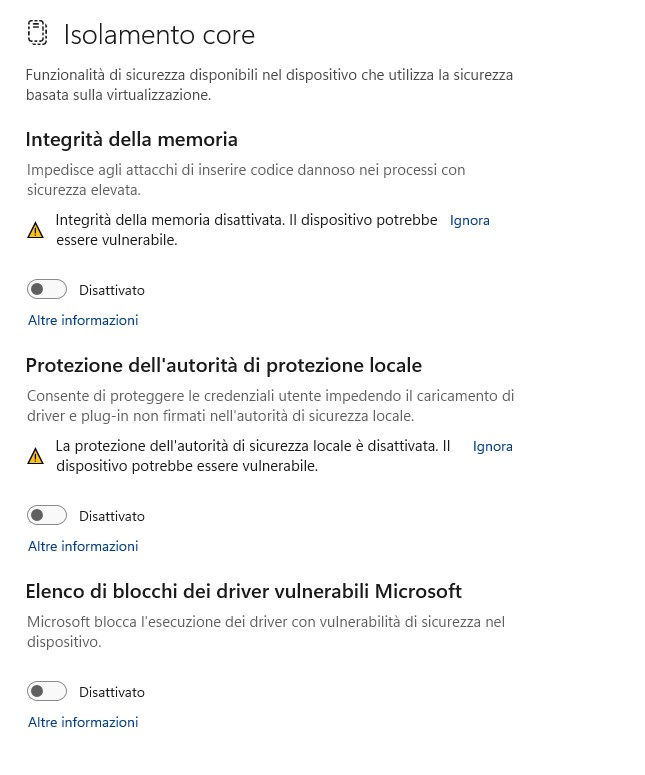

# VN7 BIOS Advanced Tabs Unlock Guide

## Step 1 – Sblocco BIOS
In Windows 11 cercare **“Privacy e sicurezza”** -> **“Isolamento core”**. Disabilitare tutto e riavviare il computer.

## Step 2 – Modifica Variabili UEFI
1. Usare il tool **H2OUVE_100.00.16.8**.
2. Usare il tool **Dump.bat** (genera il file `vars.txt`).
3. Creare una copia di questo file e nominarla `varsmod.txt`.
4. Aprire il file `varsmod.txt` e modificare le seguenti linee (**attenzione gli offset [013] e [056] potrebbbero essere diversi, basarsi sulle due stringhe "Custom" e "Setup" per individuare gli offset corretti**):
   - `[013] "Custom" -> 00000250: 00 00 00 00 00 00 00 00 01 01 00 00 00 00 01 01`
   - `[056] "Setup"  -> 00000250: 00 00 00 00 00 00 00 00 01 01 DF 07 00 01 01 01`
5. Usare il tool **Write.bat**.

Questo attiva i menu avanzati nel BIOS.
